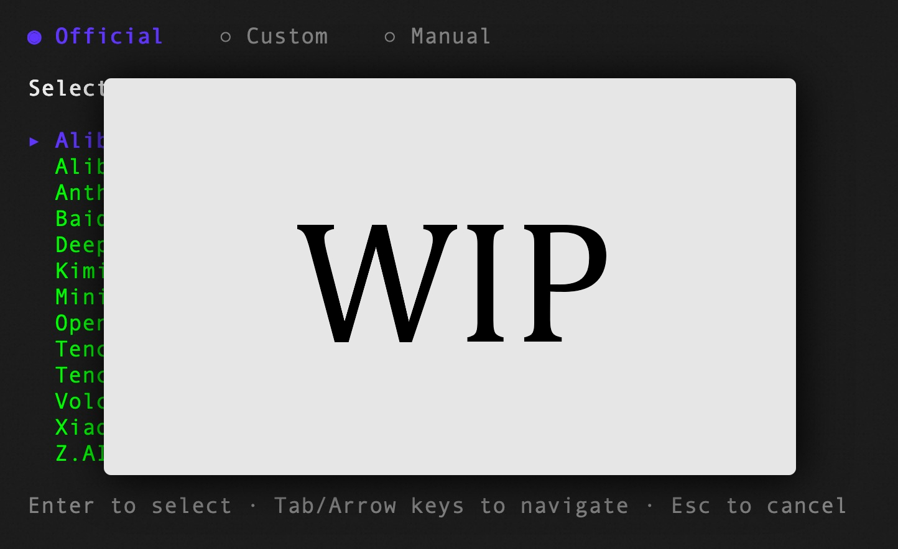

<div align="center">
  <a href="https://che3mz.github.io/kaid/">
    
  </a>
  <h1>OpenCodeReview</h1>
</div>

<p align="center">
  <a href="https://github.com/CHE3MZ/kaid/actions/workflows/release.yml"></a>
  <a href="https://github.com/CHE3MZ/kaid/blob/master/LICENSE"></a>
</p>
<p align="center">
  <a href="#supported-platforms"></a>
  <a href="#supported-platforms"></a>
  <a href="#supported-platforms"></a>
</p>

---

## What is Open Code Review?

Open Code Review is an AI-powered code review CLI tool. It originated as Alibaba Group's internal official AI code review assistant — over the past two years, it has served tens of thousands of developers and identified millions of code defects. After thorough validation at massive scale, we incubated it into an open source project for the community. Simply configure a model endpoint to get started.

It reads Git diffs, sends changed files to a configurable LLM via an agent with tool-use capabilities, and generates structured review comments with line-level precision. The agent can read full file contents, search the codebase, inspect other changed files for context, and produce deep reviews — not just surface-level diff feedback. Beyond diff review, `ocr scan` reviews entire files for auditing unfamiliar codebases or directories that have no meaningful diff.

Visit the [official website](https://che3mz.github.io/kaid/) for more details.

## Benchmark

> Compared to general-purpose coding agents, Open Code Review achieves significantly higher **Precision** and **F1** with the same underlying model, while consuming only **~1/9 of the tokens** and completing reviews faster. Note that its Recall is lower than general-purpose agents — a deliberate trade-off favoring precision over noise.

A real-world code review benchmark built from **50** popular open-source repositories, **200** real Pull Requests, and **10** programming languages — cross-validated by 80+ senior engineers (**1,505** annotated ground-truth issues).

<a href="https://huggingface.co/datasets/Alibaba-Aone/aacr-bench"> Explore the AACR-Bench dataset on Hugging Face</a>.

| Metric | What it measures | Why it matters |
|--------|-----------------|----------------|
| **F1** | Harmonic mean of precision and recall | Best single number for overall review quality |
| **Precision** | Proportion of reported issues that are real defects | Higher = fewer false alarms to triage |
| **Recall** | Proportion of real defects that are found | Higher = fewer issues slip through review |
| **Avg Time** | Wall-clock time per review | Matters for CI pipeline latency |
| **Avg Token** | Total tokens consumed per review | Directly impacts API cost |

## Why Open Code Review?

### The Problem with General-Purpose Agents

If you've used general-purpose coding agents for code review, you've likely encountered these pain points:

- **Incomplete coverage** — On larger changesets, agents tend to "cut corners," selectively reviewing only some files and missing others.
- **Position drift** — Reported issues frequently don't match the actual code location, with line numbers or file references drifting off target.
- **Unstable quality** — Natural-language-driven review prompts are hard to debug, and review quality fluctuates significantly with minor variations.

The root cause: a purely language-driven architecture lacks hard constraints on the review process.

### Core Design: Deterministic Engineering × Agent Hybrid

Open Code Review's core philosophy is to combine deterministic engineering with an agent, each handling what it does best.

**Deterministic Engineering — Hard Constraints**

For review steps that *must not go wrong*, engineering logic — not the language model — guarantees correctness:

- **Precise file selection** — Determines exactly which files need review and which should be filtered, ensuring no important change is missed.
- **Smart file bundling** — Groups related files into a single review unit (e.g., `message_en.properties` and `message_zh.properties` are bundled together). Each bundle runs as a sub-agent with isolated context — a divide-and-conquer strategy that stays stable on very large changesets and naturally supports concurrent review.
- **Fine-grained rule matching** — Matches review rules to each file's characteristics, keeping the model's attention sharply focused and eliminating information noise at the source. Compared to purely language-driven rule guidance, template-engine-based rule matching is more stable and predictable.
- **External positioning and reflection modules** — Independent comment-positioning and comment-reflection modules systematically improve both the location accuracy and content accuracy of AI feedback.

**Agent — Dynamic Decision-Making**

The agent's strengths are concentrated where they matter most — dynamic decisions and dynamic context retrieval:

- **Scenario-tuned prompts** — Prompt templates deeply optimized for code review, improving effectiveness while reducing token consumption.
- **Scenario-tuned toolset** — Distilled from deep analysis of tool-call traces in large-scale production data — including call frequency distributions, per-tool repetition rates, and the impact of new tools on the overall call chain — resulting in a purpose-built toolset that is more stable and predictable for code review than a generic agent toolkit.

## How to Use

### Prerequisites

- **Git >= 2.41** — Open Code Review relies on Git for diff generation, code search, and repository operations.

### CLI

#### Install

```bash
curl -fsSL https://raw.githubusercontent.com/CHE3MZ/kaid/master/install.sh | sh
```

On Windows:

```powershell
irm https://raw.githubusercontent.com/CHE3MZ/kaid/master/install.ps1 | iex
```

After installation, the `ocr` command is available globally.

For other installation methods (GitHub Release binary, from source), see [Installation](https://che3mz.github.io/kaid/installation/).

#### Quick Start

**1. Configure LLM**

You must configure an LLM before reviewing code, unless you use [Delegation Mode](https://che3mz.github.io/kaid/integrations/delegate/).

```bash
ocr config provider          # Select a built-in provider or add a custom one
ocr config model             # Pick a model for the active provider
```



The interactive UI guides you through provider selection, API key entry, and model configuration, then automatically tests connectivity.

For CLI setup, environment variables, custom providers, and other advanced configuration, see [Configuration](https://che3mz.github.io/kaid/configuration/).

**2. Review**

```bash
cd your-project

# Workspace mode — review all staged, unstaged, and untracked changes
ocr review

# Branch range — reviews feature-branch's changes since it diverged from main (merge-base mode)
ocr review --from main --to feature-branch

# Single commit
ocr review --commit abc123

# Resume an interrupted range or commit review
ocr session list
ocr review --from main --to feature-branch --resume <session-id>

# Full-file scan — review whole files instead of a diff (no git history needed)
ocr scan                          # scan the entire repository
ocr scan --path internal/agent    # scan a directory or specific files
ocr scan --resume <session-id>   # resume an interrupted full-file scan

# Save results to a file (recommended for AI host agents)
ocr review --format json --output result.json

# Delegation mode — let your AI coding agent perform the review itself
# OCR handles file selection and rule resolution; no LLM configuration needed
ocr delegate preview
ocr delegate rule src/main.go src/handler.go
```

## Documentation

Full documentation lives at **[che3mz.github.io/kaid](https://che3mz.github.io/kaid/)**:

- [Quickstart](https://che3mz.github.io/kaid/quickstart/) — install and run your first review
- [Installation](https://che3mz.github.io/kaid/installation/) — all platforms and installation methods
- [CLI Reference](https://che3mz.github.io/kaid/cli-reference/) — every command and flag
- [Review Rules](https://che3mz.github.io/kaid/review-rules/) — customize review rules with path filtering and targeting
- [Configuration](https://che3mz.github.io/kaid/configuration/) — config keys and environment variables
- [MCP Server](https://che3mz.github.io/kaid/mcp/) — extend the review agent with external tools
- Review Execution Modes — choose which LLM performs the review
  - [Default (OCR-managed)](https://che3mz.github.io/kaid/configuration/) — OCR runs the review using its configured LLM
  - [Delegation Mode](https://che3mz.github.io/kaid/integrations/delegate/) — your coding agent runs the review using its own LLM; no OCR API key required
- [CI/CD Integration](https://che3mz.github.io/kaid/integrations/ci/) — GitHub Actions, GitLab CI, GitFlic CI, and Gerrit integration
- [Session Viewer](https://che3mz.github.io/kaid/viewer/) — browse and replay review sessions in browser, mark comments as fixed or ignored and hide them while you work through the findings
- [Telemetry](https://che3mz.github.io/kaid/telemetry/) — OpenTelemetry integration for observability
- [FAQ](https://che3mz.github.io/kaid/faq/) — common questions and troubleshooting

## Contributing

See [AGENTS.md](AGENTS.md) for development setup and coding guidelines.

## License

[Apache-2.0](LICENSE) — Copyright 2026 alibaba/open-code-review Contributors. kaid modifications Copyright 2026 CHE3MZ. See [NOTICE](NOTICE).
