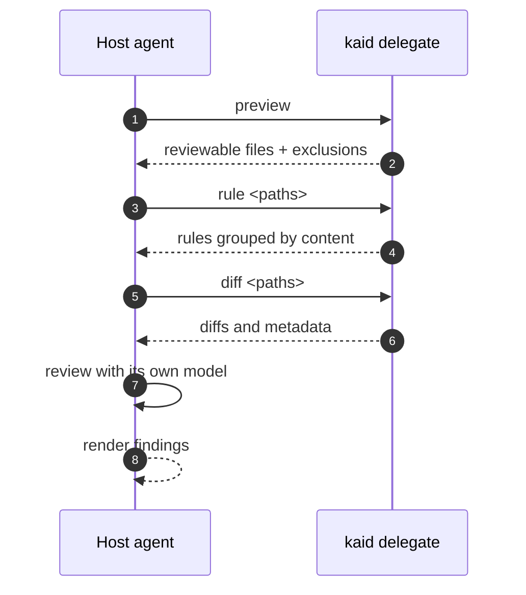

kaid handles deterministic engineering (file selection, rule resolution)
while the host agent performs the actual code review using its own LLM
capabilities. No LLM endpoint is required on the kaid side.

!!! tip "No model configuration required"

    Delegation mode never calls an LLM from the kaid side. The host agent
    supplies both the model and the review reasoning, so you do not need to run
    `kaid config provider` or set `KAID_LLM_*` variables.



## When to use delegation mode

Delegation mode is designed for subscription-based AI coding agents where you
already have an LLM subscription bundled with the host agent. Instead
of configuring a separate model endpoint for kaid, you reuse the host
agent's existing subscription quota to perform the review.

Use delegation mode when:

1. Your AI coding agent runs on a subscription plan and you want to
   reuse that quota for code review — no extra API key or model
   configuration needed.
2. You want kaid only for its engineering scaffolding — file filtering,
   rule resolution, exclusion logic — while the host agent handles all
   LLM reasoning.
3. You're building a custom agent pipeline that needs structured inputs
   (file list + rules) for its own review step.

## Prerequisites

The `kaid` CLI must be installed:

```bash
which kaid || curl -fsSL https://raw.githubusercontent.com/CHE3MZ/kaid/master/scripts/install.sh | sh
```

No LLM configuration (`kaid config set …` or environment variables) is
needed — delegation mode never calls an LLM on the kaid side.

## Workflow

### Step 1: Preview — determine what to review

```bash
kaid delegate preview [--from <ref> --to <ref>] [--commit <hash>] [--exclude <patterns>]
```

Outputs:

- **mode** — workspace / range / commit
- **ref metadata** — from, to, commit, merge\_base
- **Reviewable file list** — paths, status, insertions/deletions
- **Excluded files** — with exclusion reason

Common invocations:

| Scenario | Command |
|----------|---------|
| Workspace changes | `kaid delegate preview` |
| Branch comparison | `kaid delegate preview --from main --to feature` |
| Single commit | `kaid delegate preview -c abc123` |

### Step 2: Get rules for files

```bash
kaid delegate rule <path1> <path2> ...
```

Pass the reviewable paths from Step 1. Output is grouped by rule
content — files sharing the same rule appear under one group, avoiding
repetition.

### Step 3: Get diffs

Choose the diff command using the mode and refs from Step 1. Use `git --no-pager` for every Git call during the review.

The diff commands disable external diff programs, text conversion, and color to produce plain patches.

**Range mode** (merge\_base provided):
```bash
git --no-pager diff --no-ext-diff --no-textconv --no-color <merge_base>..<to> -- "<path>"
```

**Commit mode**:
```bash
git --no-pager show --no-ext-diff --no-textconv --no-color <commit> -- "<path>"
```

**Workspace mode**:
```bash
git --no-pager diff --no-ext-diff --no-textconv --no-color HEAD -- "<path>"        # tracked files
cat "<path>"                     # new untracked files
```

To read context:

```bash
git --no-pager log --no-color --oneline -- "<path>"
git --no-pager blame --no-textconv -- "<path>"
git --no-pager show --no-ext-diff --no-textconv --no-color "<ref>:<path>"
```

For large diffs, add `--output="<absolute-diff-file>"` to the command for the selected mode. Choose a unique absolute path outside the repository and create its parent directory. Use the same path in file-reading tool calls:

```bash
git --no-pager diff --no-ext-diff --no-textconv --no-color --output="<absolute-diff-file>" <merge_base>..<to> -- "<path>"
```

After Git exits with code 0, read and review the entire file in chunks, then remove it. If Git fails or times out, retry or record `skipped` with the error. Check unexpectedly empty output against a fresh preview.

### Step 4: Review each file

For each reviewable file:

1. Get its diff (Step 3)
2. Consult the matching Rule Group (Step 2) as the review checklist
3. Conduct a thorough review, using context exploration as needed

Record each previewed `(path, status)` as `reviewed` or `skipped`. Give a reason for every skipped entry, and report `total_files`, `reviewed_files`, `skipped_files`, and `coverage_rate`.

### Step 5: Report

Classify each finding by severity:

- **Critical/High** — bugs, security issues, data loss risks. Always report.
- **Medium** — performance concerns, error handling gaps. Report with context.
- **Low** — style nits, minor suggestions. Discard silently unless clearly valuable.

## Sub-commands reference

| Command | Purpose |
|---------|---------|
| `kaid delegate preview` | List reviewable files + mode/ref metadata |
| `kaid delegate rule <path...>` | Resolve review rules grouped by content |

## Shared flags

| Flag | Description |
|------|-------------|
| `--from <ref>` | Source ref for range mode |
| `--to <ref>` | Target ref for range mode |
| `-c, --commit <hash>` | Single commit mode |
| `--repo <path>` | Repository root (default: cwd) |
| `--rule <path>` | Custom rule.json path |
| `--exclude <patterns>` | Comma-separated exclude patterns |
| `-b, --background <text>` | Business context |
| `-B, --background-file <path>` | Business context from Markdown file (takes precedence over `-b`) |

## See Also

- [CLI Reference](../cli-reference.md) - the `kaid delegate` sub-commands and global flags.
- [Review Rules](../review-rules.md) - how `kaid delegate rule` resolves per-file text.

*[LLM]: Large Language Model
*[kaid]: kaid
